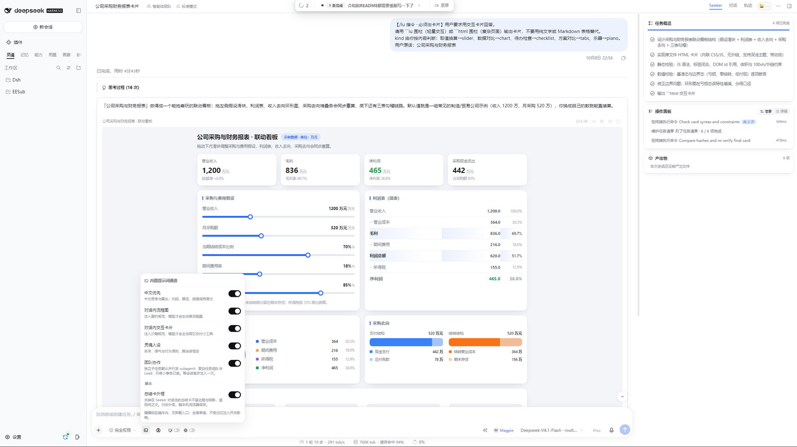
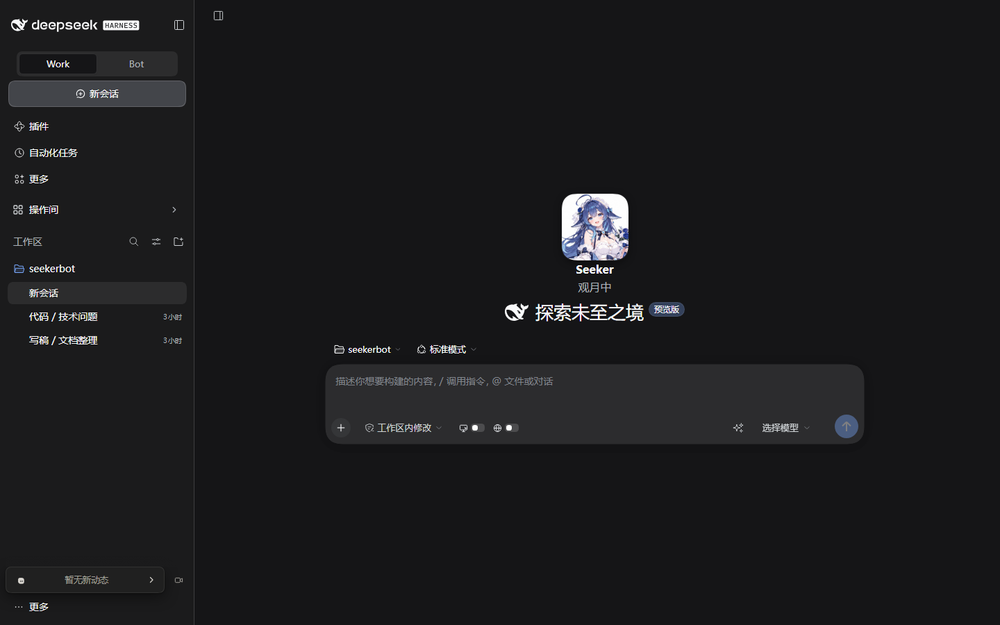
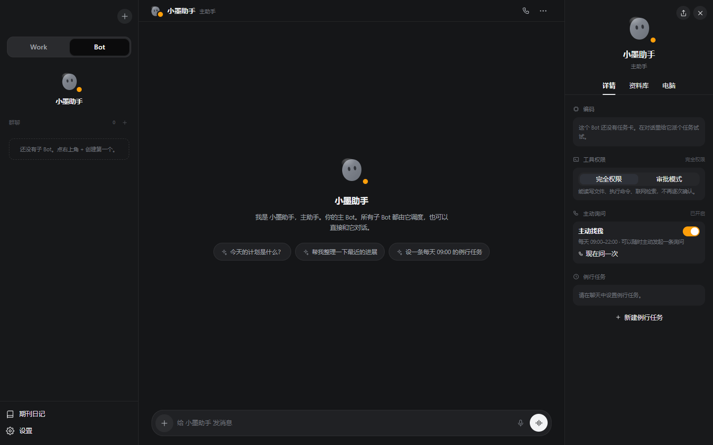
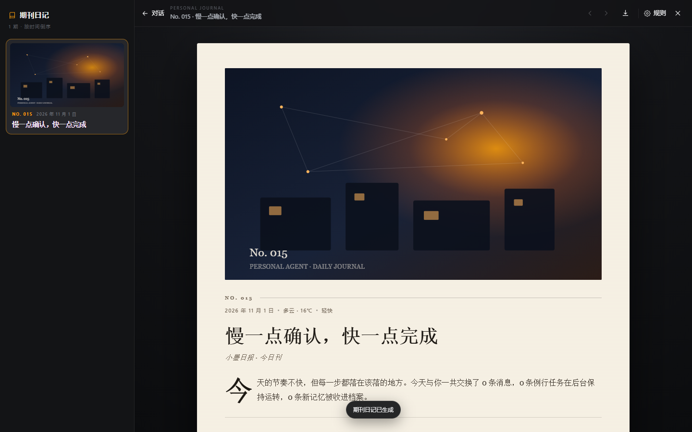
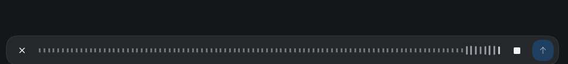
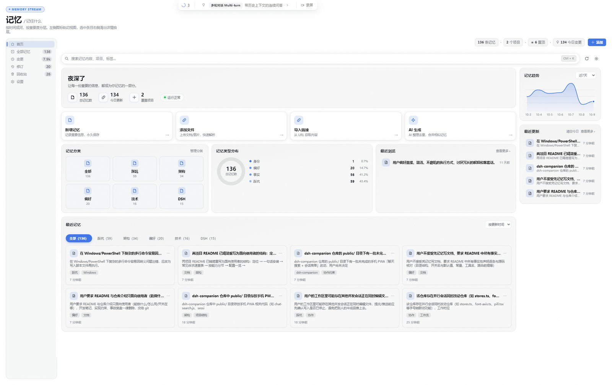
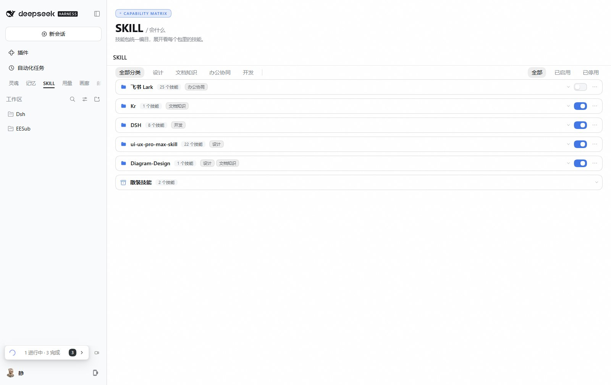
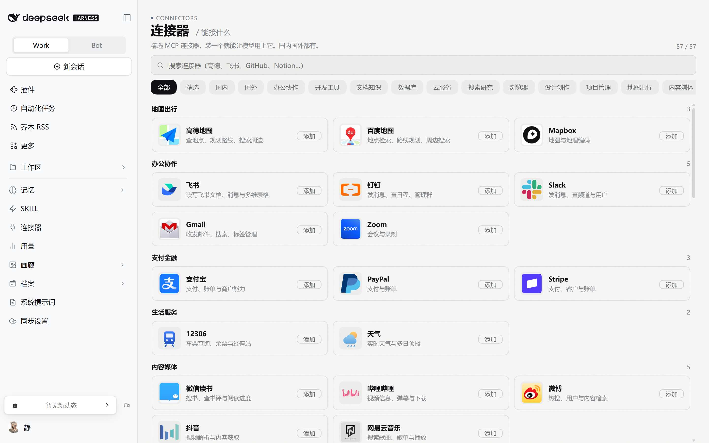
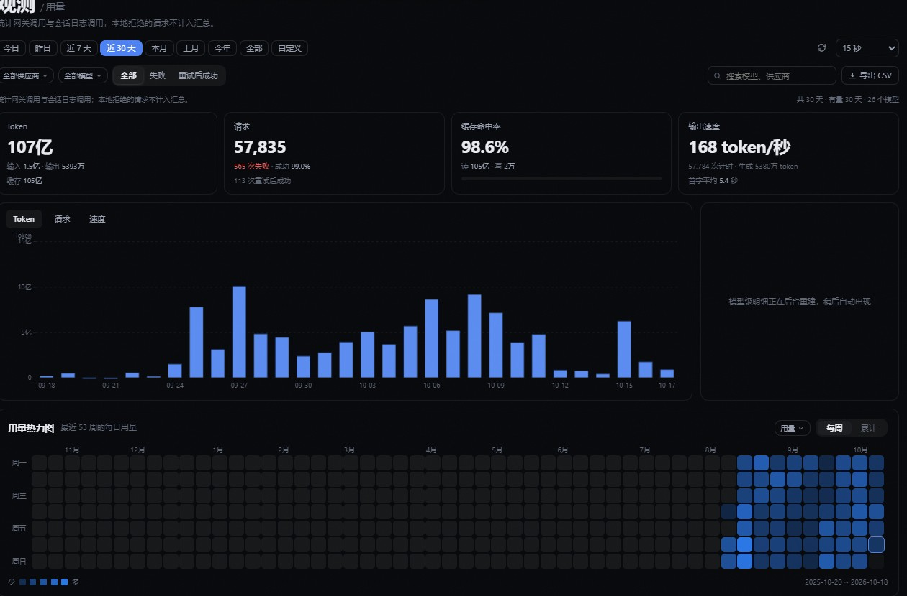
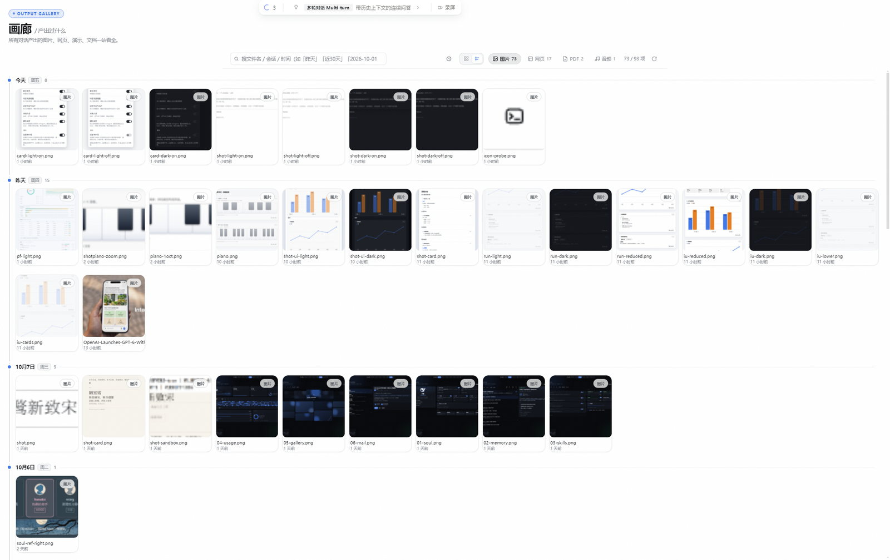

# dsh-seeker-bot

**DeepSeek Harness 的对话体验增强套件**：让对话读得更顺、能出可交互的卡片、把执行过程翻译成人话；
再把记忆 / SKILL / 连接器 / 用量 / 画廊 / 档案 / 系统提示词 / 同步设置收成一排工作台。

零 DSH 源码改动 —— 全部能力以 Cordis 插件注入，官方升级不动它。

```bash
dsh plugin --profile web add github:Kr-ATG/dsh-seeker-bot
```

装完重启 DSH 即可。本包声明了 `dsh.bundle.patch`，`dsh plugin add` 会自动加进 profile 的
bundles 层，不用手改配置文件。

---

安装/回滚请按 [docs/INSTALL-TROUBLESHOOTING.md](docs/INSTALL-TROUBLESHOOTING.md)；
**不要手工改 profile，也不要用定时 kill 重启当前 DSH**。

---

## 目录

- [你可能最想要的](#你可能最想要的)
- [Seeker 视图：双栏执行大盘](#seeker-视图双栏执行大盘)
- [正文里能出卡片](#正文里能出卡片)
- [对话读起来更顺](#对话读起来更顺)
- [对话完成胶囊](#对话完成胶囊)
- [侧边栏：工作区 ⇄ 操作间](#侧边栏工作区-操作间)
- [八个工作台](#八个工作台)

---

## 你可能最想要的

| 想要 | 在哪 |
|---|---|
| 看 AI 到底在干什么，但不想要一屏工具日志 | [Seeker 视图](#seeker-视图双栏执行大盘)右侧大盘；左栏只留一行「正在…」 |
| 让 AI 直接给个能点的小工具 / 可视化 / 演示页 | 正文里写 ` ```html ` 围栏 → [HTML 卡片](#html-沙箱卡片能跑真-htmljs) |
| 让 AI 画流程图 / 架构图 / 时序图 | 正文里写 ` ```html ` 围栏，手写内联 SVG → [HTML 卡片](#html-沙箱卡片能跑真-htmljs) |
| 快速取值换算 / 对比 / 清单，不要长篇大论 | 输入框发 `/iu 开头` → [iu 原生卡片](#iu-原生交互卡片) |
| 让 AI 知道「我现在开着什么」 | 输入框打 `@` → [运行中的程序](#运行中的程序打--直接挑窗口) |
| 给不会编程的人看「这轮做了什么」 | 右栏**操作面板**卡，中文人话时间线 |
| 跑完以后提醒我，点一下回到那条会话 | [对话完成胶囊](#对话完成胶囊)（左下角小横条 / 顶部悬浮） |
| 让 AI 记住我的偏好和身份 | 工作台**记忆** |
| 存账号密码 / 卡 / 证件照片，还要能自动进上下文 | 工作台**[档案](#档案)** |
| 存 Clash 订阅 / 配置文件 / 证书，换机也不丢 | 工作台**[档案](#档案)** → 记录详情「文件」区（随云同步上传） |
| 换机后账号密码 / 记忆 / 技能 / MCP / 供应商与密钥一起跟过来 | 工作台**[同步设置](#同步设置)** → 勾选要漫游的资产，推自己的 GitHub 私库（端侧加密） |
| 管 API Key / 代理 / 生图模型 | 官方设置弹窗 → **供应商** |
| 搜索额度打满了，自动换一家继续搜 | [网页搜索降级链](#网页搜索降级链额度没了自动换一家)（AnySearch → Tavily → DeepSeek） |
| 想要一整个 Personal Agent 团队：主 Bot + 子 Bot + 群聊 + 日记 + 通话 | 侧栏顶部 **Work / Bot** 切到 Bot → [Personal Agent](#personal-agentbot-模式) |

---

## Seeker 视图：双栏执行大盘

会话头部标签栏多一个 **「Seeker」**（内部代号 KR），与官方「对话 / 轨迹」并列。点进去，
底层仍是官方 ChatView（多轮历史、虚拟滚动、Markdown、输入框全部原样），右边多一栏全高执行大盘。

```
┌─ 左栏（官方 ChatView）────────────┬─ 右栏 Seeker 大盘 ────────────┐
│                                   │ ┌ 子智能体 ────────────────┐ │
│  [你]  …                          │ │ 固定 5 行，整行可点跳转   │ │
│  [AI]  …                          │ └──────────────────────────┘ │
│                                   │ ┌ 操作面板 ────────────────┐ │
│  (Seeker 正在读取文件 ··· 12s)     │ │ 头像 + 当前这一件事        │ │
│  ┌ 思考过程 ─────────────────┐    │ │ 默认收起，点开看完整流水   │ │
│  │ 贴在对话流里，跑时展开     │    │ └──────────────────────────┘ │
│  │ 收口自动折叠成一行         │    │ ┌ 任务 ────────────────────┐ │
│  └───────────────────────────┘    │ │ 只列本轮清单              │ │
│                                   │ └──────────────────────────┘ │
│  ┌ 最终回答（总结卡）─────────┐    │ ┌ 产出物 ──────────────────┐ │
│                                   │ │ 本次做出的文件，可点预览  │ │
│                                   │ └──────────────────────────┘ │
│                                   │ ┌ 记忆 ────────────────────┐ │
│                                   │ │ 钉在底部，默认折叠        │ │
└───────────────────────────────────┴──────────────────────────────┘

**为什么子智能体卡固定 5 行**：它顶在滚动区最上面、卡高与内容无关，所以紧贴
其下的「操作面板」永远停在同一位置 —— 子智能体多几个少几个都不会把操作面板
推走。没有子智能体时整卡不可见但位置照留（同样是为了不推动下面的卡）。
```

**左栏干净**：只有一行状态卡（头像 + 「Seeker 正在…」+ 末尾三点 + 用时读数）。工具明细不在这边堆。

**切轮次入口**：右键你自己发的那条消息，右栏大盘切到对应轮次；左键保持正常文本选择 / 复制，不触发大盘。

> **顶栏标签行位置**：`Seeker` 排在官方「对话 / 轨迹」左侧、紧贴右侧工具区，是插件用一组
> `order` 规则把标签行插到标题与工具区之间实现的（零 DOM 改动，官方按 `tabs.length` 增删
> 标签行时不会崩）。DSH `0.2.1-rc.3` 给标签行外面多包了一层 `.tabs` 容器，旧规则全部打在
> 内层 tablist 上导致标题被挤到最右、官方「…」跑到 Seeker 左边 —— 已按新结构补规则，两版
> 选择器靠 `:not([role='tablist'])` 区分，rc.2 / rc.3 都能正常显示。



**大盘设置**：「Seeker」标签右侧有一枚齿轮按钮，点开在视口中央弹出设置卡片，里面是
「提示词通道」三条（中文优先 / 对话内交互卡片 / 团队协作）、「任务清单」
两条（任务清单纪律 / 回合结束自动收口）、「展示」三条（总结卡外框 / 工具调用卡 / 操作面板），
以及下方通栏的「工作区记忆」。齿轮与卡片
联动（再点收起、Esc 关闭、点遮罩关闭），改完立刻生效、刷新后保留。

卡片约 1000×512，排版在 2026-10-25 按「拥挤、排版不合理」重做过一轮：

- **上方两栏**：左「提示词通道」3 行（中文优先 / 对话内交互卡片 / 团队协作），
  右「展示」3 行 +「任务清单」2 行（任务清单纪律 / 回合结束自动收口），中间一道发丝线。
- **任务清单组里的两行没有合并成一个开关**：任务清单纪律往提示词里写一条行为约束（开工
  先列、收尾清零），回合结束自动收口是 host 侧监听器（`agent/turn-stopping` 把残留的
  `in_progress` 改写成 `pending`），一个字都不进提示词。两者作用机理相反，绑成一个开关
  会强迫用户做无意义的交易 —— 想关掉「末项别再转圈」就得连带关掉「清单纪律」。归到同一
  组只负责「看起来归一类」。
- **下方通栏**：「工作区记忆」独占一整条，带极淡底色与上方分隔线（**不套卡片外框** ——
  面板里再套一层圆角卡就是卡中卡，本仓库老坑）。它从右栏搬下来是因为三个性质都对不上：
  它是**列表**（长度跟工作区数量走）、是**唯一按工作区存**的一组、行结构是「名称 + 路径 +
  两枚迷你开关」横排 —— 挤在 392px 右栏里路径会被截成 `D:\AI\E…`，而路径正是「哪个工作区」
  唯一无歧义的标识。
- **行内三列 grid**：标签定宽 132px / 说明弹性 / 开关定宽 40px。原来是 flex，开关跟着文字
  长度浮动，左右两栏停在两条不同的竖线上，扫「开没开」时每换一栏都要重新找位置。
- **说明常态一行**：短句只讲「这一行与别行有什么不同」，共性提到组头右侧（「每会话首步 ·
  存于 host」「本机浏览器 · 不进提示词」）。全文挂在 `title` 上，鼠标悬停 / 键盘聚焦 / 触摸
  点按任一方式都能展开 —— 是**按需展开**，不是删字。
- 窗口窄于 820px 回退单列；窄于 560px 时行降成两列（标签+开关一行、说明独占下一行）。

「工作区记忆」**列出本机全部工作区**，每个工作区两枚开关：**记录**（要不要往这个工作区攒新记忆 ——
关掉后不再自动提取、模型也不能手动记）与**不注入**（要不要把已有记忆读进它的会话）。
两件事语义相反、互不影响：关掉「记录」不影响已有记忆照常注入，打开「不注入」也不影响继续攒。
当前会话所在的工作区带「当前」角标与左侧主色竖条；列表限高可滚，工作区多了不会把下面顶出卡片。

**右栏五张卡**：

| 卡 | 讲什么 |
|---|---|
| **子智能体** | **整场会话**派出去的独立会话，一行一个、整行可点跳到那个子会话。不按轮次切分（切到哪一轮都看得全）；分**两段**、各带段标题——上面主色的「正在执行 N」（呼吸点 + 计数，无底色），下面带对勾的「已完成 N」折叠带（灰底、整条可点、带 chevron）。行首用形状图标分状态（进行中转圈 / 已结束对勾），状态同时留在 aria-label 与悬停说明里。**固定 5 行窗口**：卡高与内容无关，多出来的行在窗口内滚动（这是「操作面板位置恒定」的保证）；没有子智能体时整卡不可见但占位保留，不会让下面的卡上移 |
| **操作面板** | 把工具调用翻成中文人话（「查看文件 KrAgentPanel.tsx」而不是 `read_file(path=…)`）。卡头是**插件头像**（64×64 圆角方形，就是仓库根目录那张 `icon.png` 的 128px 版）+ 「Seeker」+ **当前这一件事**（新动作把它顶掉，**最多两排**，再长抹省略号），**默认收起**，点卡头展开完整时间线；卡头那行的耗时隐藏，明细行里的耗时保留。2026-10-30 起卡头改为**紧凑横排**：身份位左置、名字/状态右置，底部一条「N 个动作 · 展开/收起时间线」摘要行；2026-10-31 按用户要求把那块人物换成插件头像（原来 64×114 的任务动画在这张卡里撤掉了），卡头 160px → 约 110px。同一轮里新对话页 Hero 也一起换了、人物动画整条删除，见[卡头头像](#卡头头像)。措辞不出现程序、终端、命令行这类词，**也不印「在电脑上操作」这类复述图标的话** —— 终端族只留对象（模型写的 description），行首图标已经说明是哪类动作（workflow → 「执行自动流程」） |
| **任务** | **只列本轮** `todo_write` / 提交的计划，本轮没写就是空（发一条新消息不会挂着上一轮的清单）。只有回看历史轮次时才回溯到会话最近一次，并标注「会话清单」。**空时整卡不显示**（2026-10-28 用户要求「空的不要显示卡片」，右栏不留空壳） |
| **产出物** | 本次对话做出来的文件，整行可点，**按类型分流**：官方右侧栏能正常展示的（图片 / 文档 / PDF / Office / 表格 / 页面 / 音视频）就地进右栏看；侧栏展示不了的（3D 模型、压缩包、安装文件、avif/tif/heic）交给系统默认应用（Blender、解压软件、看图器）。**没有产出、或核对后文件全都不存在时整卡不显示**；多类产出按类别分组显示（网页（HTML）→ 音频 → 文档 → 图片 → 视频 / PDF / 演示 / 表格 / 3D / 压缩包 / 安装文件），卡头标注「N 项 · M 类」；每条显示具体产出时间，右键可「引用到对话框」或「使用系统默认程序打开」；子智能体会话的产出物自动并入主会话卡（行尾标注「子代理」） |
| **记忆** | 钉在底部；按需展开，只列**本会话新增**的条目（按写入来源判定，不按时间） |

**思考过程卡贴在对话流里**（不在右栏）：左侧一条 2px 竖线，无底色无投影，跑时展开跟随、
收口自动折叠成一行让位给正式回答——回复落定后不再占屏，点标题行随时能再展开重读。

**与官方「设置 → 字号」联动**：左栏思考卡 + 右栏五张卡的字号、行高、图标全部跟随官方字号设置。
字号 14（默认）时与你之前的观感逐像素一致，调大调小会一起变。

> 右栏被挤压时（窗口窄 / 记忆卡内容多），操作面板与记忆卡会自动缩一档。
> 「思考 / 产出物」等卡片各有独立开关。

卡头长这样（深色 / 浅色，截自 1440px 宽窗口的右栏）：


### 卡头 Git 大盘入口

操作面板卡头上，头像右侧那排按钮里有一枚 **Git 分支图标**（在设置按钮旁边），
图标右上角还会挂一枚简约小角标（淡色小圆片，Git 用主色），直接显示 **Git 大盘里有多少个仓库
（工作区 + 自制插件）有未提交改动**（0 时隐藏，三位数折成 99+；一个仓库改 11 个文件也只算 1，
不是文件条数），把「现在还有几个项目没提交」直接摆在眼前。点击图标打开**「工作区与自制插件 Git 大盘」**
（`GET /api/chat-flow/git-roster`）：把工作区本身和每个自制插件仓库各自的改动状况收在一张表里，
一眼看出哪个仓库有东西没提交，并可一键新建会话处理。

### 卡头头像

右栏操作面板卡与新对话页 Hero 卡头，身份位都是**插件头像** —— 就是仓库根目录那张
`icon.png`（256×256，插件图标本身）压到 128×128 后内联进 client 产物的那一张
（`src/client/kr-chat/brand-avatar.ts`，base64 约 55 KB，不走任何路由、没有网络请求）。

尺寸由 CSS 分两档：**Hero 96×96**、**右栏紧凑骨架 64×64**，圆角都取边长的约 28%
（方形圆角而不是圆形：原图是 256×256 的方形构图，裁圆会把两侧花束切掉）。



> 2026-10-31 之前这里是一套 9 段透明底 WebM 人物动画（按状态切换：思考 / 操作中 /
> 查看照片 / 收尾 / 完成 / 吃饭 / 观月 / 小憩）。用户先要求「操作面板的这个人物删除
> 替换为我们的插件头像」，再要求「新对话的也换上，之前那个人物彻底删除」—— 于是
> 播放器、片段表、状态判定、18 个素材文件、host 的 `/api/chat-flow/motion` 路由、
> 以及 `view.task-motion` / `host.motion` 两个特性开关一并删除，两处卡头只剩这一张图。

---

## 正文里能出卡片

### 流程图卡片（历史兼容）

早期版本用 ` ```diagram ` 围栏画流程图，要模型**手工给出每个节点的坐标与折线点**——
画歪是常态，且这个能力有独立开关、默认关，模型多半不知道它存在，常年闲置。

现在流程图 / 架构图 / 时序图 / 任何示意图，一律用 ` ```html ` 围栏**手写内联 SVG**
（见下一节）。iu 曾有的 `graph` / `arch` / `sequence` 三个图形 kind 已整块下线：
它们只能画算法排版的拓扑图，视觉上限被组件锁死，而图形恰恰最吃设计感。
能力文档随「html 卡片」通道默认注入，直接说「画个架构图」即可。

> ` ```diagram ` 围栏的**渲染器仍然保留**：历史消息里的老围栏照常渲染成 SVG 卡片
> （节点 / 连线 / 分支标注 / 三档比例），不会变成一坨 JSON。只是不再往提示词里注入
> 它的规范，模型也不会再主动产出——那个独立开关早已移除。

### HTML 沙箱卡片（能跑真 HTML/JS）

````
```html
<h1>计数器</h1>
<button id="b">+1</button><p id="v">0</p>
<script>
let n = 0
document.getElementById('b').onclick = () => { document.getElementById('v').textContent = ++n }
</script>
```
````

对话流里出现的就是这张卡本身，**没有任何常驻控件**（2026-10-19 起把标题栏、源码/复制、
缩放、重载、全屏整组砍掉）：卡片是正文的一部分，不是嵌进来的组件。
里面是真在跑的 HTML/JS —— 小工具、计算器、图表、可视化、单页原型都能直接交付。

**内置设计系统（kit）**：正文里出现 `k-` 类名或 `--k-` 变量时自动注入，不写 CSS 也能
得到与宿主同一套视觉语言 —— `.k-title` / `.k-lede` / `.k-h` 排版，`.k-num` 等宽数字，
`.k-rule` 发丝分隔线，`.k-kv` 键值两栏，`.k-grid` / `.k-cols` 自适应多列，`.k-bar` /
`.k-track` 条状图元，`.k-swatch` + `.k-a1`~`.k-a4` 色标。尺寸全部跟随官方「设置 → 字号」
缩放（内部是 `--k-scale`），不写死 px。

**内置交互（按需注入，不用自己写 JS）**：`data-tooltip="…"` 提示气泡（hover / 键盘聚焦 /
触摸点按，Escape 关闭）；`.k-tabs` + `role="tablist"` 页签（点击与方向键已接管）；
`__dshState.set({…})` / `__dshState.ready(fn)` 把交互状态持久化，刷新不丢；
`window.__dshFill(text)` 把结果回填输入框，由你确认后发送。

**安全**：卡片跑在独立 iframe 里，只给 `allow-scripts`、**不给 `allow-same-origin`** ——
卡片里的脚本读不到你的会话数据与页面 DOM。高度自适应上报；点卡片里的链接会开新标签页。

**流式期先出占位卡**：模型逐字吐 HTML 时先显示「正在预渲染…」，围栏闭合后**原地**变成真卡片。
空内容、只有注释、语言标记不是精确的 `html`，都会**回退成代码块**（你能看到原文，
而不是一张空白框）。

> 这个能力**默认开启** —— 它是交付形态本身，不注入模型就永远想不起来用。

### iu 原生交互卡片

输入框以 `/iu` 开头，这条消息会**连 `/iu` 一起**原样发给模型，模型据此出卡。十二种：

| kind | 用途 | 样子 |
|---|---|---|
| `slider` | 取值换算（按人数算用量、按面积算预算…） | 拖动滑块，右侧实时出各项结果 |
| `table` | 数据行列 | 可排序表格：点表头切换升 / 降序，数字列右对齐 |
| `checklist` | 待办清单 | 可勾选，带进度条 |
| `tabs` | 方案对比 | 页签切换 |
| `kanban` | 任务分列 | 拖拽看板：卡片可跨列拖动，也有点选 →「移到这里」的触摸 / 键盘通路 |
| `form` | 收集输入 | 文本 / 数字 / 下拉 / 勾选 / 多行五类字段，必填项失焦才提示，填完一键回填输入框 |
| `timeline` | 时间安排 | 竖向 / 横向时间线，节点三态（完成 / 进行中 / 待办），点击展开详情 |
| `diff` | 前后修改 | 行级对比（自算 LCS），统一 / 并排两种视图，可只看变更行 |
| `tree` | 层级结构 | 可折叠树，点箭头展开 / 收起子树 |
| `gauge` | 完成度 / 指标 | 半圆仪表或圆环进度，可带阈值变色（绿 / 黄 / 红），最多 4 个并排 |
| `quiz` | 考察理解 | 单选 / 多选自测卡，答题后揭示对错与解析，答完出得分 |
| `piano` | 钢琴 | 点键或用键盘 `A W S E D F T G Y H U J K` 演奏，可把弹过的音写成音名+简谱回填输入框 |

原生卡（不走 iframe）体积小、不白屏，还能把结果**一键回填输入框**由你确认后发送。
**卡片状态会记住**：勾过的清单、拖过的滑块、移过的看板卡片、切过的页签、填了一半的表单，
都存本地（localStorage），刷新页面不丢。

> 图形**不再走 iu**：`graph` / `arch` / `sequence` 三个图形 kind 已整块下线，图表 kind
> `chart` 也已下线 —— iu 只能画算法排版的拓扑图，而图形最吃设计感。现在任何示意图都写
> ` ```html ` 围栏手写内联 SVG（见上一节），文档随「html 卡片」通道默认注入。
> 历史消息里的 ` ```graph ` / ` ```diagram ` 围栏仍照常渲染（渲染器保留，只是模型不再产出）。

每张 iu 卡右上角只有**全屏**（Esc 退出，全屏态不再持久化——否则刷新后整页滚不动）。
缩放档位按钮已按用户要求移除：卡片字号统一跟随官方「设置 → 字号」，不再自成一档。

细节记不住没关系 —— 直接说「用 /iu 给我算一下」「用 /iu 做个对比」即可。

### @ 不会把普通中文变成文件芯片

官方 `@` 文件引用的判据只要求「`@` 前面是空白、后面跟一串非空白字符」，**不检查那串
东西像不像路径**。中文里不打空格，于是「`@的时候不是实时获取的`」这种写法会被认成一个
叫「的时候不是实时获取的」的文件，文件当然不存在 —— 那段文字就渲染成一枚**蓝色虚线芯片**。

这里用一条 order 更小的 user-text 规则抢在官方前面，只把**不像路径的 `@`** 盖回普通文字。
判据：带引号 `@"..."` / 含 `/` 或 `\` / 含扩展名 / 纯 ASCII 且至少一个字母 —— 满足任一才算
路径。所以 `@的时候`、`@帮我看看`、`@3.5` 都是纯文字，而 `@src/main.ts`、`@README.md`、
菜单里选的 `@package.json` 照旧是芯片。

### 可交互卡片（proto-tabs）

` ```tabs ` 围栏 → 可点的页签卡片，适合并列展示几套方案。

### 运行中的程序：打 @ 直接挑窗口

输入框打 `@`，候选里除了官方的文件 / 会话，最上面多一组 **「运行中的程序」** —— 你此刻
真的开着的窗口，每条带**真实进程图标** + 窗口标题，右侧一行灰字是程序名（浏览器窗口写
`Chrome` / `Edge`）。前台窗口排第一，最小化的排最后。

选中后草稿里落一枚 `@ 窗口标题` 的芯片，**模型收到的是结构化上下文**：

```text
[运行中的程序] 程序：chrome；窗口标题：Example Domain - Google Chrome；
路径：C:\Program Files (x86)\Google\Chrome\Application\chrome.exe；状态：当前前台窗口
```

于是「帮我把这个页面整理成笔记」「这个报错窗口是什么问题」这类话不用再说程序名 —— 指一下就够。

**怎么采集的**：host 半身用一个**常驻 PowerShell 子进程**枚举可见顶层窗口（标题 / 进程 /
图标 / 前台 / 最小化），暴露只读路由 `GET /api/chat-flow/running-apps`。首次冷启动约
600~700ms，之后每次往返 **2~4ms**（客户端还有 30s 缓存 + 后台刷新）。

**过滤掉什么**：托盘浮层、输入法候选窗、`Progman` / `Shell_TrayWnd` 这类桌面外壳、
Chrome 的「翻译此页？」气泡、`TextInputHost` 等系统提示宿主 —— 都有实测依据，见
`src/running-apps/collect.ts` 的注释。

**失败面**：采集器不可用时整组静默消失，官方的文件 / 会话候选照常工作，界面上不报错。
客户端只保留两层不算缓存的机制：并发去重（同一时刻一个请求）与失败兜底（用上一次成功的结果）。
宿主被强杀（任务管理器结束进程 / 崩溃）时，采集器由 C# 看门狗线程 `TerminateProcess`
自我终止，不会在机器上留下孤儿 `pwsh`。

---

## 对话读起来更顺

| 能力 | 说明 |
|---|---|
| **思考行 / 工具行** | 与官方同款的折叠行，实时走秒 + 分步跟随滚动 |
| **步骤卡 / 总结卡** | 回合中间是步骤卡，最终回复独立成总结卡。总结卡外观可在工作台记忆页里改成纯正文（去框去影） |
| **共享活动抽屉** | 点思考 / 工具行打开，思考按语义分组、工具调用成树 |
| **裸路径自动变链接** | 正文里出现的文件路径自动变成可点链接，点了在右栏预览；整段只有一个图片路径时**直接渲染成图** |
| **对话滚动守卫** | 你手动往上翻时不被新内容拽回底部 |
| **滚动条自动隐藏** | 对话流滚动条在停止滚动 3 秒后淡出，再次滚动时出现；槽位常驻，不引起内容跳动 |
| **重试行影子** | 模型重试时显示官方同款试次行 |
| **生图实时卡** | 生图时按本次图片比例与张数画出点阵动画，`generate_image` 一返回就在对话流里显示成图（不等总结）；多图仍收成一条画廊 |

**生图实时卡**（2026-10-30）：`generate_image` 一开跑，对话流末尾就出现点阵动画卡 ——
点阵按本次 `size` / `aspect_ratio` 的比例分格（1:1 方阵、16:9 宽阵、9:16 高阵），`n` 张就画
n 个格子，不是一整块铺满宽度的大方阵；中性色圆点按径向波呼吸（跟随深浅主题，不使用橙色），
不是转圈也不是一行文字。工具结果一返回，同一张卡立刻换成成图，不必等回合收口后的总结卡；
模型还在落盘 / 写最终回答时图已经在了。点阵换成图片时做 0.55s 的羽化过渡（图片从
blur(10px) 显影、下面一层点阵同步淡出），不是硬切。回合收口后由总结卡里的画廊条接管，
多图并排、点击放大、另存为全部沿用画廊条。**正文自己已经贴了图时不再补画廊条**（避免
同一张图出现两遍）；只有正文只写文字 / 文件路径时才用画廊兜底。

**动效**（移植自 `aa2246740/dsh-better-display`，MIT）：思考两行步进跟随、流式新文字淡入、
忙碌标签微光、展开收起过渡。全部只动 `opacity` / `transform`，并在系统开启
「减少动态效果」时自动关闭。

## 对话完成胶囊

移植自 `dsh-companion` 的 done-pill 模块。任一会话（含后台会话）回合结束时提醒一次；点胶囊直接跳进那条会话，悬停滑出「进行中 + 最近完成」面板，看问题与回复全文。

| 能力 | 说明 |
|---|---|
| **两种形态** | 左下角小横条（默认，侧边栏设置行上方）/ 顶部悬浮可拖拽胶囊；设置里「胶囊形态」切换，位置与配置都记住 |
| **两种形态都有** | 会话标题 + 用户问题摘要 + 完成数；左下角卡在 56px 窄栏退化为带数标徽的图标钮 |
| **任务完成提醒** | 三条通道：原生 Notification → 壳页面桌面浮窗（经 host CDP）→ 页内动效卡兜底；系统通道成功时不再弹页内卡；提示音只响一次 |
| **录屏成 GIF** | 胶囊右侧录屏按钮：整屏 / 框选区域 / 单个窗口（host 用 Win32 PrintWindow 抓窗口自身，免遮挡，支持子窗口）；帧率与输出宽度可调 |
| **待机机器人** | 完全空闲时播放 OpenBotMotion 待机动作（9 种基础动作 + 稀有 dance，减少动效时定格） |
| **运行中笔画** | 有回合在跑时显示转圈笔画与实时用时；完成后转为未读点 |
| **健康提醒** | 「休息时间」「凌晨注意休息」两个时段开关，到点胶囊持续提示 |
| **跟随字号** | 尺寸跟随官方「设置 → 字号」（--dsh-content-font-size），另有「胶囊大小」「胶囊字体」两个自有设置 |

设置入口：官方「设置 → 通用」里新增 9 行（胶囊形态 / 对话完成胶囊 / 任务完成提醒 / 休息时间提醒 / 凌晨注意休息 / 胶囊大小 / 胶囊字体 / 录屏帧率 / 录屏画质）。

```text
┌ 左下角小横条（默认形态）──────────────┐
│ ● 3 个对话完成 · 「整理会议纪要」摘要… │  ← 侧边栏设置行上方
└────────────────────────────────────────┘
   悬停/点按 → 上方滑出「进行中 + 最近完成」面板
```

> 从 `dsh-companion` 迁入：存储键（`dsh.donePill.*`）、样式类名与宿主路由保持原样，浏览器里的已读状态、位置与外观设置无缝延续。`dsh-companion` 若同时启用，两套胶囊会重复显示——只保留一个即可（本插件已内置完整胶囊，不需要再开 companion 的 pill 模块）。

---

## 侧边栏：工作区 ⇄ 操作间

侧边栏「更多」下面只有一行切换菜单，两屏互斥：

| 当前显示 | 那一行写 | 点它之后 |
| --- | --- | --- |
| 工作区（会话 / 工作区列表） | **操作间** | 工作区收起，下面列出记忆 / SKILL / 连接器 / 用量 / 画廊 / 档案 / 系统提示词 / 同步设置 |
| 操作间（八个工作台入口） | **工作区** | 那八个条目收起，会话列表回来 |

也就是「这一行永远写着点下去会去哪」。当前停在哪一屏会记住（刷新不跳屏），
从任何一个工作台页回到会话时自动切回**工作区**——否则在操作间里点「新会话」
会看不到会话列表。

侧栏折叠成 56px 图标态时，这条二级导航整块让位，官方「工作台」图标行接管
（那里放不下一整屏二级导航），入口在任何形态下都不会丢。

### 顶部的 Work / Bot 分段控件

品牌行下面那枚「Work | Bot」分段控件来自本插件（`src/client/mode-switch/`）。
2026-11-01 起 **Bot 模式重新开放**：点 Bot 会切到全屏 Personal Agent（见下一节），
点应用里的 Work 回到官方工作台。模式记在 `localStorage` 的 `dsh-seeker-bot.ui-mode`，
刷新后保持。

这枚控件与 Bot 应用左侧栏里的 `.pa-mode-seg` 是**同一套视觉规格**（容器 4px 内边距 /
13px 圆角 / 3px 缝，按钮 34px 高 / 10px 圆角 / 14px 字），位置也钉在同一处：
左边距 14px、顶边 y=74（品牌行 66px 底 + 8px 间距）。两个模式来回切时，分段不会
跳尺寸也不会跳位置；改一边记得同步另一边。

---

## Personal Agent（Bot 模式）

Bot 模式是一个覆盖整个 DSH Web 视口的自绘应用，参考截图逐项复刻：
左侧 248px 的 Bot 名册、中间微信式聊天、右侧 300px 的 Bot 详情栏。

**首次进入只有主 Bot**：不再预置任何演示子 Bot、群聊、消息、记忆、例行任务或期刊；
旧版本留在 localStorage 里的七个演示 Bot 与示例数据会在第一次加载时自动迁移清理，
只保留主 Bot 和用户自己创建的内容。



### 布局与交互

| 区域 | 内容 |
|---|---|
| 左侧栏 | 顶部「+」（新建 Bot）→ Work/Bot 切换器 → 主 Bot（48px 头像 + 在线点）→ 子 Bot 分组 → 群聊 → 底部「期刊日记 / 设置」 |
| 聊天区 | 会话头（44px 头像 / 名称 / 角色 / 电话呼叫 / 更多）、消息流、输入框（附件 / 粘贴图片 / 白色圆形语音或发送键；录音时整块切换成语音条） |
| 右侧栏 | 详情 / 资料库 / 电脑三个 tab：任务卡、工具权限、主动询问、例行任务、主 Bot 的子 Bot 管理（有子 Bot 时才出现）；记忆检索；文件树 + 终端 |
| 弹层 | 新建 Bot、群聊设置、新建群聊、例行任务、设置、期刊阅读器、通话卡片 |

- **自适应主题**：默认「跟随」DSH 当前主题（读 `body[data-ds-dark-theme]` 与
  body 实际底色，系统深浅切换也会同步）；设置里可强制「深色 / 浅色」。所有面板、
  气泡、输入框、弹窗与右栏都有对应浅色 token，不是只换背景色。
- **主 Bot 控制子 Bot**：主 Bot 右栏「子 Bot 管理」可暂停/启用、改名、移动分组、删除；
  子 Bot 可自主在各自会话里主动询问、跑例行任务、维护独立记忆。
- **分组**：设置弹窗里可新建 / 改名 / 删除分组；每个子 Bot 行悬浮 `...` 可移动到任一分组。
- **群聊**：左侧「群聊」标题旁的 + 新建群聊（选成员 + 起名）；群内可 `@成员`，
  成员用各自模型回复并以发送者头像/名字标记；群聊设置支持「跟随各自 Bot / 全组统一模型」。
- **主动询问**：每个 Bot 右栏「主动询问」可开关；点「现在问一次」立即发一条带选项的询问；
  新建 Bot 创建后由真实模型按岗位发第一条自我介绍与问题。
- **例行任务**：每个 Bot 都可新建（每天 / 每 2 小时 / 每周一）、启停、立即运行、删除；
  页面开着时每 30 秒检查到期任务并真实发消息。
- **记忆隔离**：每个 Bot 的「资料库」只列自己的记忆；主 Bot 的资料库列出全部 Bot 的记忆并标注来源。
- **期刊日记**：到达第二天 0:00–8:00 且连续 30 分钟没有任何用户主动对话时自动生成前一天的
  总结日记；期刊为米白纸张 + 衬线标题 + 16:9 宽幅配图（调用生图模型，失败回退程序化封面）。
  侧栏「期刊日记」可翻期、查看规则、立即检查或模拟 07:30 触发。

  
- **语音输入（与 Work 模式同链路）**：输入框麦克风不是 `webkitSpeechRecognition`，
  而是 MediaRecorder 录音 → 16 kHz 单声道 WAV → `ctx.remote.speech.transcribe`
  （本机 SenseVoice，与 Work 模式同一条 ASR）。录音时整块输入框换成一条语音条：
  左「X」取消、中间一排实时音量波形（静音时是点阵基线，说话时跟着起伏）、
  右「停止方块 + 发送箭头」；停止后先转写（「正在转写…」），转写完成即**收起语音条**
  并把文字并入输入框——不自动发送，确认后用输入框的发送键发出；点 X 随时丢弃。

  
- **图片输入**：输入框里直接 Ctrl+V 粘贴截图（或点「+」选图片）→ 缩略图预览 → 随消息发出。
  图片先经 `POST /api/personal-agent/upload` 落盘到 bot 工作区的 `uploads/`，消息里只存
  同源 URL（`/file?path=…`），刷新、重开都还在；宿主会把图片路径写进这一轮的 user 消息
  提示，bot 需要看内容时自己 `read_image`。支持 PNG / JPEG / GIF / WebP，单张上限 12MB。

  
- **通话是真实链路**：麦克风录音 → DSH ASR → 该 Bot 配置的真实模型回复（宿主
  `/api/personal-agent/reply`）→ Edge TTS 播放；弹窗里能看到「正在思考」、逐条转写，
  也可直接打字作为麦克风不可用时的兜底。最小化收起到右栏顶部，挂断后写一条默认折叠的
  「语音通话」消息到该 Bot 会话，展开可见来源、发生时间、最终时长与逐条转写。
- **对话内交互 UI**：选项 / 按钮 / 表单卡片可直接操作；提交后追加用户消息、Bot 继续回复，
  部分表单会真实创建例行任务；卡片标记「已提交」防重复。
- **动效**：每条消息上滑入场（`pa-rise` 260ms）、弹窗缩放淡入、通话呼吸波纹、列表选中态 120ms。

### 回复形态：Bot 是聊天，不是工作台

Bot 跑的是宿主完整的 agent loop（工具、技能、MCP 全都在），但**输出形态按对话设计**，
和 Work 模式刻意不一样：

- **正文精炼**：1–3 句、最多两小段，先结论后补充；不用加粗伪标题、多级清单、表格、
  代码块，不贴文件路径 / 命令 / 参数（用户明确说「详细说 / 报告 / 清单 / 代码」才展开）。
- **过程不进正文**：工具调用块在 Bot 消息里默认不渲染（`generate_image` 例外，出图卡直接
  落在对话流里），正文最多一句「我看了下」——过程属于界面，不属于消息。
- **Work 专属提示段被摘掉**：每个 Bot 的 agent 作用域里会过滤 `team:policy`（Agent Teams
  协作纪律）、`ui:deliverable-file-references`（present / 文件路径链接规则）、
  `app:web-surface`（Web GUI 与 HMR 说明）、`harness:source`（实现 checkout 位置）。
  实现在 `src/host/personal/agent.ts` 的 `trimWorkOnlyPrompt()`：全局段用同名空 section
  覆盖，`team:policy` 走 `system-prompt/assemble` waterfall 过滤（它是 agent 作用域注册的，
  同名覆盖会撞注册表，实测会把建会话流程带崩）。实测 bot 的系统提示从 ~8.7k 字符降到 ~4.3k。
- **一份契约两个入口**：契约写在 `buildBotPrompt()`；agent 不可用时的降级路径
  （`/reply` 的 chat 补全）用同一份措辞，避免「同一个 bot 换个入口就换了语气」。

### 撤回一条消息（连上下文和记忆一起）

用户消息气泡 hover / 触屏常显「↺ 撤回」，确认后同时做三件事：

1. **删本地消息**：这条用户消息 + 它之后到下一条用户消息之前的全部消息（含 pending、
   群聊里同轮多个 Bot 的回复），原位置插一条「你撤回了一条消息」系统提示；
2. **删记忆**：该时间窗口内、这一轮参与 Bot 记下的记忆条目（`MemoryEntry`）；
3. **撤上下文**：`POST /api/personal-agent/recall` → `src/host/personal/recall.ts` 在
   agent 会话的 surface 上追加一条 `replace` 事件，把该轮所有节点（用户消息 + 注入上下文
   + assistant 回复 + 工具结果）整体遮蔽。日志保留，之后的模型请求重建历史时看不到它们。

实现要点（踩过的坑都写在代码注释里）：

- Session 日志 append-only，但 surface 支持 `replace`（compaction 同一机制）；
  遮蔽区间必须覆盖每一个 surface 节点（`sourceEventSeqs`），否则宿主校验拒绝。
- 找目标消息只认 `source.kind === 'user'`：宿主会往 user 角色塞注入上下文
  （agent-instructions / runtime-context / system-reminder），按它们切区间会把撤回缩成一条。
- 撤回节点是 `developer/message`，`source.kind` 必须写成 `plugin:dsh-seeker-bot`；
  v3 的 `plugin` 包装会被 v4 落盘校验拒绝，表现为「当场生效、重启后又想起来了」。
- append 后必须 `sessions.flush()`：不落盘的话，下一次 turn 会被 pre-step 判成 blocked。

> 语义边界：撤回只影响**之后的模型上下文**。模型在产生那条回复的那一步已经看过原文，
> 这里保证的是「后续对话不再带着它」。

### 数据与真实能力

- 前端状态持久化在 `localStorage` 的 `pa:state:v1`（Bot / 群聊 / 消息 / 记忆 / 任务 / 期刊）。
- Host 路由 `/api/personal-agent` 提供九项真实能力（任一项失败都自动回退本地引擎）：
  - `POST /reply`：用宿主 `ctx.llm.stream` 按该 Bot 配置的 provider/model 生成回复；
  - `POST /reply/stream`：同一条回复的 SSE 流（`text` / `tool` / `error` / `done`），
    Bot 对话据此实时显示正文与工具进度（生图 / 生视频占位卡靠它出现）；
  - `POST /journal/image`：调用当前生图模型生成 16:9 期刊配图，落盘到
    `~/.dsh/storages/dsh-seeker-bot/personal-agent/journals/`；
  - `POST /tts`：本机 `edge-tts` 生成 mp3（Edge 在线语音）；
  - `POST /asr`：宿主 `speechController`（本机 SenseVoice）转写；
  - `GET /file`：bot 工作区里的媒体文件（生图 / 生视频落盘产物与正文里的文件）。相对
    路径以 bot 工作区为基准，图片 24MB、其它媒体 256MB；视频 / 音频支持 HTTP Range
    （`206` + `content-range`，浏览器可拖动进度条），`mov` 按 `video/mp4` 声明。
  - `GET /office/info|page|pdf`：Office / PDF 预览（复用 `src/office` 的 LibreOffice
    页图与 PDF 转换），准入与 `/file` 同一套工作区闸门。
- **生图 / 生视频实时卡（与 Work 模式一致）**：bot 调 `generate_image` 时，对话流里先出现
  按本次图片比例 / 张数呼吸的点阵占位；工具结果一回来（含被 spill 的大结果——host
  会读回全文、把 base64 解码落盘到 `<bot 工作区>\_tmp\generated-images\`），同位置
  换成真实图片，点开是大图。`generate_video` 同理：生成中显示「正在生成视频」点阵 +
  实时秒数 + 提示词；结果里有视频 URL / b64 就落盘到 `_tmp\generated-media\` 并内嵌
  `<video>` 播放，网关返回异步任务时显示「视频任务已创建」（id + 状态）。
- **视频与 Office 产出物**：模型最终回复里写到的本地文件（`_tmp/report.docx`、
  `D:\...\x.pdf`、`_tmp/demo.mp4` 等，markdown 链接或裸路径都认）会渲染成产出物卡：
  图标 + 文件名 + 类型 + 大小 + 预览 / 下载。PDF 直接内嵌浏览器查看器，Office 先出首页
  页图、展开后转 PDF 预览，视频 / 音频用原生 `<video>` / `<audio>`；工具结果里识别到的
  文件（`present` 的 path、pwsh / run_code 落盘）也会以同样卡片出现。正文已经贴了图片
  时工具卡不再重复显示同一张图，图片过期（`_tmp` 被清理）则显示「图片已过期」而不是裂图。
- 独立演示页（不依赖 DSH，数据存 localStorage）：

```bash
npm run build:personal-demo
# 打开 dist/personal-agent/index.html
```

> 独立演示页没有 DSH 宿主：模型回复/ASR/TTS 会回退到本地演示引擎，界面与交互仍可完整体验；
> 需要真实模型、语音识别与通话语音时，请在 DSH 应用内使用 Bot 模式（并刷新一次页面）。
> 参考素材里没有给出新建 Bot / 通话 / 期刊三种界面的原图，这三块按截图同一套设计语言延伸实现。

### 二级菜单：手风琴

记忆（工作区）、画廊（八个类别）、档案（场景）这几行展开后列出的子项，是**手风琴**：

- 点开「画廊」，之前展开的「记忆」在同一拍收起，**同一时刻只有一组子项展开**；
- 展开态记在 localStorage 的 `dsh-sidebar-expanded-menu`，刷新后仍是上次那一行；
- 实现是「展开 = 覆盖成单值」（`writeExpandedMenus`），渲染层只判断自己那行，
  所以互斥是数据结构自带的，不需要每次点开头再遍历兄弟行去收一遍。

档案的场景子项还多一层**三级分组**（账号与登录 / 支付与联系方式 / 证件与文件）：分组行
点击只展开 / 收起，叶子节点才切换场景；默认展开当前选中项所在组，自定义场景平铺在分组之后。

> 旧版本允许多行同时展开，存量数据里可能还留着 `memory,gallery` 这种多值。
> `readExpandedMenus` 只认第一个，任何一次展开/收起都会把它写回单值——升级后
> 不会出现「一进来所有行全撑开」。

### 加一个新菜单（给二次开发）

侧栏二级导航是**注册表驱动**的：`src/client/triad/hub/nav-registry.ts` 里两级数据
——区域（section）与条目（entry），侧栏只按表渲染。加一个菜单不需要碰挂载器、
样式或显隐逻辑：

```ts
// 打开某个官方 main 面板（例：加一个「任务」菜单）
ctx.effect(() => navMenuItem({
  id: 'tasks', label: '任务', icon: MyTasksIcon, panelId: 'schedule',
}), 'dsh-seeker-bot: 任务菜单')

// 打开工作台的某个分类
ctx.effect(() => navMenuItem({
  id: 'gallery-entry', label: '画廊', icon: MyGalleryIcon, workbenchTab: 'gallery',
}), 'dsh-seeker-bot: 画廊菜单')

// 自定义动作（弹浮层、发命令……）
ctx.effect(() => navMenuItem({
  id: 'custom', label: '随便什么', icon: MyIcon, run: () => { /* ... */ },
}), 'dsh-seeker-bot: 自定义菜单')

// 再加一整屏（第三个区域，按 order 轮转）
ctx.effect(() => navSection({
  id: 'tools', label: '工具间', icon: MyIcon, order: 30,
}), 'dsh-seeker-bot: 工具间区域')
```

条目缺省落在**操作间**（`section` 不写就是它），`order` 决定行序（工作台七个
条目占 10–70）。注册返回的 dispose 交给 `ctx.effect` 回收，热重载不残留；
同 id 重复注册 = 覆盖，不会叠出两份。

---

## 网页搜索降级链：额度没了自动换一家

宿主 `ctx.web` 的 seam 只会选**一个**搜索后端，失败就是失败——`WebRuntime.search()` 是
`selectSearchProvider().search()` 一行，`web.searchProvider` 的注释还写明它「不是隐藏优先级链」，
registry 也是私有 `Map`（插件枚举不到别的后端）。所以「额度打满自动切」只能长在插件这一侧：
本包注册单入口 `anysearch-auto`，在**自己拥有的三个实现**之间按失败类别降级，宿主永远只看到一个 provider。

| 顺序 | 后端 | 说明 |
|---|---|---|
| 1 | `anysearch` | 复用原 AnySearch 实例，已有端点 / key / 条数配置零迁移 |
| 2 | `tavily` | 需要凭据 `TAVILY_API_KEY`；没有时预检直接跳过，不报错也不白打 |
| 3 | `deepseek-official` | 走 Anthropic 兼容 Messages + 原生 `web_search_20250305`，最贵（每次一个模型 turn），所以放最后 |

**什么情况才切**（判定在 `src/provider/modules/web-search-failure.ts`，实测报文形状写在文件头）：

| 失败 | 归类 | 行为 |
|---|---|---|
| HTTP 402 / 432 / 433、报文含 quota/额度/欠费 | `WEB_QUOTA_EXCEEDED` | 切下一家，该环冷却 30 分钟 |
| HTTP 429 / 434 | `WEB_RATE_LIMITED` | 切，冷却听 `Retry-After`（封顶 15 分钟），没有就 60 秒 |
| HTTP 401 / 403 | `WEB_AUTH_FAILED` | 切，冷却 10 分钟（等你换 key） |
| HTTP 5xx、连不上、响应体读不动 | `WEB_UNAVAILABLE` | 切，但**不冷却**——下次仍先试它（它结果最好） |
| 没配 key | `WEB_PROVIDER_CREDENTIAL_MISSING` | 切，不冷却；链还会先用 `ready()` 预检，省掉一次必败往返 |
| HTTP 400 这类查询本身有问题 | `WEB_PROVIDER_ERROR` | **不切**——换一家也必败，只会白烧一次额度 |
| 用户停止生成 | `WEB_ABORTED` | **不切**，原样上抛。把取消误判成故障会导致停止后继续往下几家猛打 |

两处反锁死兜底：全部环都在冷却时忽略冷却重走一遍；全部环凭据预检不过时照样试——
`available()` 是同步的、读不到异步凭据库，不能让预检变成否决权。

启用与回退（profile 的 `cordis.patch.yml`）：

```yaml
- id: web
  name: '@deepseek-ai/dsh-web'
  config:
    searchProvider: anysearch-auto   # 改回 anysearch 即回退到单体，无需改代码
    fetchProvider: http
```

链的顺序、额度冷却时长、两个后备后端的端点与凭据引用都在 settings 命名空间 `web-search-auto`
（默认 `order: anysearch,tavily,deepseek`、`quotaCooldownMinutes: 30`）。**注意目前没有专门的设置页
卡片**：宿主「网页搜索」页只认 `web-search-deepseek` / `web-deepseek-api` / `web` 三个命名空间，
不改这些时用的是上面的默认值。

一个诚实的限制：`WebSearchResult` 只有 `sources` / `content` / `truncated`，没有字段携带「这次实际
用了哪家」，所以实际后端只进日志（`[hub/web-search-auto]` 前缀），对话卡片上的来源标签不变。

---

## 八个工作台

侧边栏工作台，每页独立：

### 记忆

自动沉淀的长期记忆：每轮对话后由模型提炼值得跨会话保留的事实（你的偏好、项目约定、踩过的坑），
按项目 / 全局分层。可在面板里增删改、置顶、按标签检索。在左栏选中某个项目后，列表头下方
出现一条项目上下文条，可改**别名**、可**清空该项目的全部记忆**（置顶记忆会保留）。

两个按工作区的开关（**记录**要不要往这个项目里攒新记忆、**不注入**这个项目的记忆要不要
进上下文）不在这个面板里 —— 它们在 Seeker 的 [大盘设置](#seeker-视图双栏执行大盘)
卡片里，按工作区逐个列出、一次能拨完好几个。一处入口、一份真相。



### SKILL

管理技能（Skill）：安装 / 停用 / 查看说明 / 归入技能包 / 设置分类。技能包与状态筛选在同一行，
分类在左、启用状态在右。



### 连接器

MCP 连接器市场：**57 个精选连接器**（国内 14 / 国外 43），按 17 个中文分类分组，
带搜索、精选 / 国内 / 国外三条快筛，点开卡片看详情、填密钥、一键安装。

目录**不接第三方市场**——数据随包分发在 `assets/mcp-catalog/catalog.json`，图标自托管在
`assets/mcp-catalog/icons/`。这么做是照抄主流开源 agent 的成熟做法：Cline 用
`cline.github.io/marketplace/catalog.json`（203 条）、Hermes 用仓库里 66 个 `manifest.yaml`、
Cherry Studio 直接硬编码 12 条——**没有一家接第三方全量市场**，规模都在 3~203 条之间。

每条都验过：包在 npm / PyPI 上真实存在（`npm view` / `pypi.org/pypi` 全部 200），
图标是真品牌图（ModelScope 封面 / GitHub 组织头像 / 官网 favicon，全部 ≥64px），
条目之间按仓库地址与安装配置双重去重。

安装落地为 `cordis.patch.yml` 里的一条 `@deepseek-ai/dsh-mcp-client` 实例（与
[SKILL 面板的 MCP 启停](#skill)同一份配置、同一套语义）。mcp-client 条目增删不走热重载，
所以装完页面会明确提示**重启 DSH 后生效**——不假装已经连上。

国内那半边是这批连接器的差异点：高德地图、百度地图、飞书、钉钉、支付宝、12306、微信读书、
哔哩哔哩、微博、京东、淘宝、抖音、网易云音乐、天气。Cline 和 Hermes 一条国内都没有。

Gmail 用的是 `@gongrzhe/server-gmail-autoauth-mcp`（v1.1.11）：首次使用要在终端跑一次
`npx @gongrzhe/server-gmail-autoauth-mcp auth`，浏览器登录 Google 账号后凭据存在
`~/.gmail-mcp/`，之后不用再授权。Google 官方的 `gmailmcp.googleapis.com` 端点在国内直连不可达，
所以没有采用远程 HTTP 方案。



### 观测 / 用量

整页是一块观测大盘：顶部范围胶囊（今日 / 昨日 / 近 7 天 / 近 30 天 / 本月 / 上月 / 今年 /
全部 / 自定义）+ 自动刷新间隔；第二行供应商 / 模型下拉、请求状态分段（全部 / 失败 /
重试后成功）、关键字搜索与 CSV 导出。

四张 KPI 卡：**Token**（输入 / 输出 / 缓存拆分）、**请求**（失败数、成功率、重试后成功）、
**缓存命中率**（带进度条）、**输出速度**（token/秒 + 首字平均）。中段按日堆叠柱状图，
三档口径 Token / 请求 / 速度可切，悬浮出卡片式 tooltip、点某天下钻；右栏是「拆分维度」
列表（模型 / 供应商两个维度，同色系与柱图对齐）。底部 52 周活动热力图。

进入页面默认落在「**今日**」：中段趋势图按 **24 小时（00:00–23:00）** 出柱，能看出一天里的
用量分布；切到其它范围（近 7 天 / 本月 / 自定义等）恢复按日聚合。

版面**铺满可用宽度**：KPI 用 auto-fit 栅格（宽屏均分、窄屏折行），右栏宽度 clamp 到 22%，
热力图格子按容器实测宽度在 12–28px 之间自适应，断点用容器查询而不是视口查询——工作台
既可能全屏也可能嵌在窄栏里。



### 画廊

所有对话生成的**图片 / 网页 / 演示 / 文档 / 表格 / 音视频**一页看全：跨会话增量索引、
类别筛选、搜索、跳回来源会话。

点任意一张卡片 = 用**系统默认应用**打开这个文件（2026-10-20）—— 图进看图器、视频进
播放器、PPT 进 PowerPoint，与你双击资源管理器里的图标完全一致。走官方 `open-in-app`
那条 `shell-open` 链路（`remote.session.openWorkspacePath`），不自建路由。

> 产出物卡的口径与画廊不同（2026-10-22）：**侧栏能正常展示的类型走侧栏**（图片 /
> 文档 / PDF / Office / 表格 / 页面 / 音视频），展示不了的才交给系统默认应用。
> 判据逐扩展名核验过（含 `ods` 的接管、`avif/tif/heic` 这类"看着像图但官方不认"的
> 坑），见 `src/client/sidebar-display.ts`。

**本机没有桌面时（手机远程访问 / 纯服务端部署）自动退回内置预览**：可内联的进就地
弹窗（图片缩放、视频播放、html 沙箱 iframe、PDF / Office 页图翻页），不可内联的走
官方右栏，行为与升级前一致。那个弹窗右上角也留着一枚「用默认应用打开」，本地看到
想拿去用的那一刻就能直接送出去。

生图与生视频的结果原本只存在于 spill 的文本里，打开前会先由 host 落成真正的
png / mp4 —— 直接把 `.txt` 交给系统只会弹记事本。

每个类别标签上写着**该类的真实条目数**（图片几百张就显示几百，不做 99+ 之类的截断）。

时间轴视图（默认视图）的方格在 2026-10-24 整体放大约 21%：最小列宽 150 → 182px、
gutter 10 → 14px，缩略图与占位图标同步加法，格子仍是 1:1 正方形。四种格式
（图片 / 网页 / 视频 / 音频）共用同一套方格尺寸，换类别不会跳变。

同一次改动里去掉了方格右上角的类型徽标（分类已经在工具条上选定，每格再挂一枚纯属
噪声）；2026-10-25 又把**文件名与时间从常驻改成 hover 浮层**：默认格子是干净的正方形
缩略图，鼠标移上来（或键盘聚焦）时以自下而上的渐变浮层淡入在缩略图**内部的下缘**，
压图显示。一屏因此多放一整行（实测 6 行 → 缩略图 187×187、日期分组间距压到 2px）。
网格视图的文件名仍是常驻，未受影响。

**删除**有两条路，互不干扰：

- **按类别整批删**：每个类别标签带一枚删除键 —— 点它，标签原地变成「删除 N 项？不可恢复
  确认 / 取消」，确认后把这个类别下的条目**连同磁盘文件一起删掉**（不可恢复，所以有
  这一步二次确认；按 Esc 或点别处即取消，几秒不操作也会自动收回）。
- **单条删**（2026-10-24）：鼠标移到任意卡片上，右上角浮现一枚垃圾桶 ——
  第一次点变成红底「删除?」，再点一次才真删。键盘用户聚焦卡片后按 `Delete` /
  `Backspace` 走同一套两拍语义。确认态没有自动回退（视线就在这张卡上，自动收回
  反而像静默失败），取消出口是点别处 / Esc。

两条路都先播淡出退场再发请求；若有个别文件删不掉（被占用、已不存在），它们会留在
画廊里并给出原因。删除只作用于画廊索引里的普通文件，符号链接与目录一律拒删，也不会
连带删除目录内容。



> 图库缩略图是**真实首页位图**而不是类型图标。PDF / Office 由插件的侧栏渲染器接管
> （官方内嵌 pdf.js 对带 /ID 的 PDF 会崩），音视频由插件的媒体渲染器接管 —— 官方把
> mp4 / mp3 这类后缀列为「没有渲染器」，不接管的话侧栏只会说一句「不支持预览」。

### 档案

**「不管工作区关不关记忆，它都会自动记录并自动注入」**——这是档案与记忆最根本的区别。
记忆库的两道闸门（按工作区「记录 / 不注入」）对档案**完全不生效**：档案有自己的
`autoRecord` / `autoInject` 开关，默认全开，且注入以 `prepend` 优先级注册，
跑在记忆库那两道闸门之前。

一页管完七类结构化信息：**账号密码 / 邮箱与登录 / 支付方式 / 联系方式 / 证件 /
配置文件 / 其它**，分组可改名、可加自定义分组。页面是「概览 + 场景切换 + 记录卡片网格」
的形态：顶部 Hero 给记录 / 场景 / 照片 / 占用的四格统计，下面一排场景胶囊切换视图，
每条记录是一张卡片，点开在卡片下方**原地展开**详情（不遮页面、不滑抽屉）。深色模式
页面底固定 #151517。每条记录是一个实体（一个站点账号、一张卡、一份证件），字段级就地
更新——「密码从 A 变成 B」是一次字段 patch 加一行历史，不是一个追加句子。证件这类
场景可以挂**图片**（正面 / 反面 / 补充），浏览器侧压成三档再传上来。

#### 四条不变量（改代码时不要破坏）

| # | 不变量 | 为什么 |
|---|---|---|
| 1 | **敏感值落盘必加密**（密文带 `secret:v1:` 前缀，AES-GCM，密钥是 `key` 文件里的 32 字节随机数、权限 0600） | 任何备份 / 同步 / 误打包都等于明文泄露 |
| 2 | **敏感值绝不进上下文**：注入里只有「密码：已加密」，连长度都不给 | 注入内容会发给模型厂商；长度本身能缩小暴力空间 |
| 3 | **列表响应里敏感值是掩码**（八个星号），明文只经 `POST /reveal` 单字段取一次并写审计 | 否则「打开档案页」就等于「整库明文进浏览器内存」 |
| 4 | **提交回来的掩码不会被当成新值** | 一次保存就把真密码写成六个星号，且不可逆 |

模型那侧默认可见：`vault_search` / `vault_get` / `vault_remember` 三个查询写入工具，
外加**默认开启**的 `vault_ssh` / `vault_http` 两个内置凭据动作。所有工具都拿不到密码明文。

#### 内置凭据动作：能用，但看不见

密码锁在档案里、模型拿不到，很多事就帮不上忙。档案内置了两个**默认开启、零配置**的动作：

- `vault_ssh`：用记录里的 SSH 密码或私钥，登录**记录自己的主机**执行远程命令；
  主机 / 用户名 / 端口只能从记录字段推导，模型不能另行指定。
- `vault_http`：用记录里的 API Key / Web Key 请求**记录自己的 URL**；
  目标域名必须落在记录 URL 字段的域名内，凭据只放进指定请求头。

不需要装 sshpass、不需要配置程序白名单；不想用就在「操作间 → 档案 → 代用」里取消
「允许内置 SSH / HTTP 动作」。密码只在本机用于 SSH 握手 / 请求头，返回值里的原文、
URL 编码、base64、hex 变体一律替换成 `********`；每次代用写 `audit.jsonl`，可在同一
面板里看最近的记录。

> ⚠ 边界：`vault_ssh` 目前信任记录里的主机（不做 known_hosts 校验），首次连接陌生
> 主机前请自己确认地址；`vault_http` 只允许访问记录自己的 URL 域名，防止密钥被发到别处。

#### 谁来写：主 agent 当场写，后台抽取兜底

2026-10-26 起写入以**主 agent 自己调 `vault_remember`** 为主：用户这一轮说出新的账号 /
密码 / 证件信息，模型当场写进去，**当轮即时生效**（用户下一句就能用）。`turn/end` 的
后台抽取退为兜底——模型漏调时仍能捡到，不会丢数据。两条路写同一份 store，靠
「场景 + 归一化标题」去重、`patchField` 的「值没变就不写」保证重复写幂等，不需要额外互斥。

这么改的原因很实际：抽取是回合**结束之后**跑的，写入永远滞后一轮。原来的注入规则
甚至明说「正常对话即可，回合结束会自动抽取入库」，等于劝住模型别自己写——于是用户
刚给完密码紧接着说「那你去登一下」，模型手上还是旧值。

**自动抽取的结果也直接生效，没有「待确认」环节。** 写进去是什么样，模型下一轮就读到
什么样：记录上没有「待确认」状态、页面没有确认 / 驳回按钮、也没有 `POST /confirm` 路由。

> 这里原本有一套「抽取结果挂 pending、等用户点确认/驳回才算数」的机制，2026-10-27 用户
> 明确要求**档案不需要确认**，整套退役（`VAULT_SCHEMA_VERSION` 1→2）。理由是那道闸门
> 同样把「当场写、当场用」拖住了：模型明明在会话里听见「密码改了」，档案里却还是旧值、
> 页面还堆着一栏待确认。现在护栏只剩三条——update 只改模型明确点名的字段、create 先按
> 「场景 + 归一化标题」查重、`patchField` 值没变就不写——改错了也只错在那一个字段上，
> 下一轮抽取还能改回来。老库里已经挂着的 pending 标记由 `migrate` 的 v1→v2 一级
> **主动删掉**（不是「从此不再写」），否则会留下一条永远挂着、页面上却没有入口能处置的
> 假状态。

> ⚠ **这条路上绕不开的一件事**：模型自写意味着明文要经过模型厂商一次。官方的 `tool/call`
> 事件保存的是模型产出的**原始 `arguments` JSON 串**（`dsh-session` 类型里原话：
> *the raw arguments JSON string exactly as the model produced it*），而 `ToolCallBlock`
> 属于 `ContentBlockMap`，会随 assistant message 在后续每一轮重发给 provider。所以明文
> 与其他对话内容同级别地走了厂商、并留在会话历史里。后台抽取同样要发给模型才能抽出
> 字段（只是不落在主会话历史里）。两条路都做不到「模型不看见明文」——真正的零暴露
> 只有用户自己在页面手录。代码里因此把「参数里传一次是必须的，但**不要在回复正文里
> 复述**」写成硬纪律，把凭空多出来的那一份副本消掉。

#### 存储与占用

```
<DSH_HOME>/memories/dsh-chat-vault/
  vault.json            记录 + 分组（几 KB~几百 KB，原子写 tmp+rename）
  key                   32 字节 AES-256 密钥（0600）
  blobs/<2位>/<sha256>  图片与文件字节，内容寻址：同样的字节只存一份（照片压三档、文件原样存）
  blobs/index.json      blob 索引 + 引用计数
  revisions/<日期>.json 每日快照（「回到昨天」）
  audit.jsonl           敏感字段明文查看 / 凭据代用审计
```

占用的三档压缩实测（同一张 2.1MB 原图，JPEG q75）：

| 档位 | 长边 | 体积 | 占比 | 用在哪 |
|---|---|---|---|
| thumb | 512 | 36KB | 1.7% | 列表 / 网格 |
| display | 1600 | 270KB | 12% | 详情 / 灯箱 |
| original | 原样 | 2100KB | 100% | 默认不存（`keepOriginal`） |

配额默认 512MB，超出时按 `original → display` 顺序淘汰，**缩略图和记录文本永不删**
（照片全没了，账号密码也还在——这是「有损但不会丢命」的方向）。

### 同步设置

把工作台资产推到自己的 **GitHub 私库**，换机一键拉回来。端侧加密（scrypt + AES-256-GCM），
离开本机的只有密文；同步口令与 GitHub 令牌用本机硬件密钥加密落盘，插件里不出现任何
私库名或 Token（公开仓库会被硬拦，不是提示）。

同步范围五项，各自可关：

| 资产 | 收的是什么 |
|---|---|
| 档案 | `vault.json` + 主密钥 + 图片 / 文件 blob（账号密码、卡、证件、订阅配置） |
| 长期记忆 | `entries.json`、状态元数据、各工作区 `meta.json` |
| 自定义技能 | `~/.dsh/skills/` 下的技能包与 `SKILL.md`（技能开关写在 frontmatter 里，跟着走） |
| MCP 配置 | `cordis.patch.yml` 里的 `mcp-client` 条目（服务配置 + `disabled` 开关） |
| 供应商与密钥 | `cordis.patch.yml` 里的 `llm-pi-ai` / `llm-deepseek` / `agent-default-model`、`~/.dsh/.credentials.yaml` 里的 API 密钥 `refs`、`model-capabilities.json`（模型能力）与 `network-proxy.json`（网络代理） |

MCP 与供应商配置均为**文本级增量读写**：注释、其它插件条目与行尾风格原样保留。拉取时同名条目/同名 Key 覆盖、本机缺失的新增，**本机独有的条目与私有 API 密钥绝不会因为云端包而丢失**；写前自动备份 `*.bak-before-sync`。条目与凭据均在端侧强加密后离开本机。
